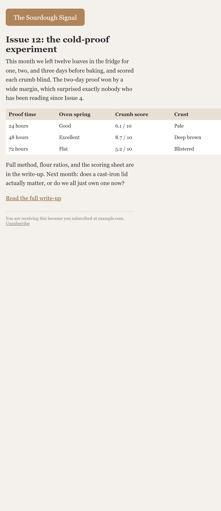
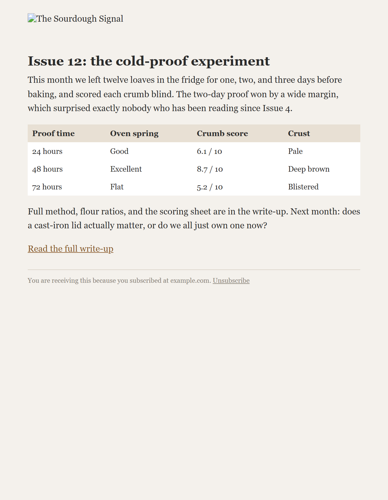

# email-preview

See your HTML email the way recipients actually receive it: dark mode, blocked
images, phone widths. One command, no service, no account.

The render in your editor is not the render your recipient sees. A large share
of opens happen on phones around 390px wide. Outlook blocks remote images by
default, and Gmail does too for senders it does not know, so plenty of people
see your email with every image replaced by alt text. And dark mode is now a
client setting, not an edge case. An email that looks right in your browser at
desktop width can still ship with a table that forces sideways scrolling on a
phone, or lose its entire identity the moment images are off.

This script renders one HTML file through all of those conditions in a private
headless Chrome and writes a screenshot of each, so you can look at every
variant before anyone else does. It also measures the two failures that are
easy to miss and hard to forgive:

- **Horizontal overflow.** Any element wider than the viewport is reported
  with its tag and a text snippet, and the script exits non-zero, so you can
  use it as a pre-send check in CI or a git hook.
- **Image/text balance.** Image pixel area and text character count per
  render, useful for spotting the all-image email that becomes an empty page
  when images are blocked.

## Install and run

Requirements: Python 3.8+, Google Chrome or Chromium installed, and one small
pip package.

```
pip install websocket-client
python email_preview.py your-email.html
```

That renders `your-email.html` at 700px and 390px, in light mode, dark mode,
and with images blocked -- six PNGs in a `render/` directory next to your
file. Options:

```
python email_preview.py your-email.html --out shots --widths 700,390,320
```

Chrome is found automatically in the usual install locations on Windows,
macOS, and Linux, then on `PATH`. If yours lives somewhere else, set
`CHROME_PATH` to the full path of the binary. The browser is launched
headless with a throwaway profile on an OS-assigned debug port, so it never
touches your own browser or profile, and everything is cleaned up on exit.

## Example

`examples/newsletter.html` is a small fictional newsletter with a classic
bug: a fixed-width 600px results table. It looks fine at desktop width.

```
$ python email_preview.py examples/newsletter.html
 700px light  ok       scrollW=700   imgs=1 imgPx=10560   chars=651
 700px dark   ok       scrollW=700   imgs=1 imgPx=10560   chars=651
 700px noimg  ok       scrollW=700   imgs=1 imgPx=10560   chars=651
        images-off text begins: 'Issue 12: the cold-proof experiment This month we left twelve loaves...'
 390px light  OVERFLOW scrollW=616   imgs=1 imgPx=10560   chars=651
        offenders: [{'tag': 'table', 'right': 616, 'txt': 'Proof time Oven spring Crumb score Crust'}, ...]
 390px dark   OVERFLOW scrollW=616   ...
 390px noimg  OVERFLOW scrollW=616   ...

OVERFLOW FOUND
$ echo $?
1
```

At 390px the phone render bleeds off the right edge, and the offender list
points straight at the table:



With images blocked, the logo is gone but the alt text keeps the sender
identifiable -- this render is where emails with an image-only header lose
their identity entirely:



One honest detail about the example: its dark render matches its light
render, because the sample declares explicit colors everywhere. The dark pass
emulates `prefers-color-scheme: dark`; whether anything changes is exactly
what you are testing. An email with dark-mode media queries will show its
dark styles here, and an email that leaves colors to the client will show
whatever Chrome decides.

## Limitations

- This is Chrome (Blink). Gmail's web client is close; Outlook on Windows
  (Word engine) and Apple Mail (WebKit) are not, and neither are the many
  clients that rewrite or strip CSS before rendering. This tool catches
  layout and identity failures that show up in a standards-ish engine; it is
  not a substitute for testing in the clients your audience uses.
- Dark mode is emulated as the `prefers-color-scheme` media feature. Some
  clients go further and forcibly invert or recolor emails; that behavior is
  client-specific and not simulated.
- Blocked images are simulated by breaking every `img` src after load, so
  alt text renders. CSS background images are not touched.
- Rendering waits a fixed ~1.4s per shot rather than for a load event, which
  is plenty for email-sized documents but not tuned for heavy pages.
- Local `file://` rendering: remote images in your email will load from the
  network in the light/dark passes if your machine is online.

## License

MIT, see [LICENSE](LICENSE).

---

Built and used in production at [Weio](https://weio.ai/?utm_source=github&utm_medium=referral&utm_campaign=oss-tools&utm_content=email-preview).
